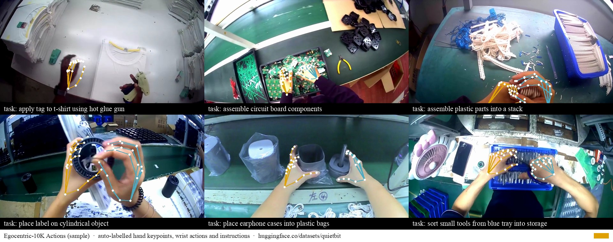

# ego2lerobot

**Turn first-person video into robot training data.** Point it at head-mounted or chest-mounted video of people working. It finds the hands in every frame, lifts them to 3D, derives wrist and grip actions, cuts the video into sub-steps at action boundaries and writes a checked instruction for each one. The output is a [LeRobot v3](https://huggingface.co/docs/lerobot/en/lerobot-dataset-v3) dataset you can train on directly.



**Sample output:** [arete-robotics/egocentric-10k-actions-sample](https://huggingface.co/datasets/arete-robotics/egocentric-10k-actions-sample) has 211 episodes from 28 factories in [Egocentric-10K](https://huggingface.co/datasets/builddotai/Egocentric-10K), labelled with this tool on one Mac mini in about two hours.

**Stereo sample output:** [arete-robotics/stereo-hands-sample](https://huggingface.co/datasets/arete-robotics/stereo-hands-sample) has 106 steps of household and kitchen work from a calibrated head-mounted stereo pair, with both hands triangulated in 3D, finger joint angles, the head pose and the hands in a world frame.

## Install
```bash
pip install git+https://github.com/arete-robotics/ego2lerobot
# instructions from a vision-language model (Apple silicon):
pip install "ego2lerobot[caption] @ git+https://github.com/arete-robotics/ego2lerobot"
# ... or on Linux with an NVIDIA GPU (see docs/linux_gpu.md):
pip install "ego2lerobot[caption-cuda] @ git+https://github.com/arete-robotics/ego2lerobot"
```

## Use
```bash
# Calibrated camera (OpenCV pinhole or fisheye intrinsics as JSON, e.g. Egocentric-10K's intrinsics.json)
ego2lerobot run videos/*.mp4 --out my_dataset --intrinsics intrinsics.json --caption --preview previews/

# Uncalibrated video: give the horizontal field of view instead
ego2lerobot run clip.mp4 --out my_dataset --hfov 90 --default-task "fold the towel"

# Ultra-wide action camera at 4K/60 fps: make 1080p/30 fps proxies first, then use the nominal fisheye preset
ego2lerobot prepare raw/*.MP4 --out proxy/
ego2lerobot run proxy/*.mp4 --out my_dataset --camera action-ultrawide --preview previews/
```
`--camera action-ultrawide` is a nominal lens (equidistant fisheye, 124° horizontal, from a 155° spec-sheet FOV), not a
calibration; a checkerboard calibration passed as `--intrinsics` is always better. `--rectify` runs hand detection on a
rectilinear view of a fisheye frame and maps the keypoints back; it is off by default because on calibrated
Egocentric-10K fisheye clips it found fewer hands than the raw frame. How to film: [docs/capture_advice.md](docs/capture_advice.md).

Every run also writes **`qc_report.md`** (plus `.json` and `.html`) into the dataset: detection rate per hand, hands
cut by the image border, wrist jitter and implausible distances, step lengths, dropped segments with reasons,
caption coverage, the share of captions that passed verification, and unusable time ranges. These are automatic
checks without ground truth.

**Step types.** A workstation repeats a few kinds of step. With `--step-vocab` the model picks one of them for each
step instead of writing a free caption:
```bash
# a text file with one imperative step type per line ('#' starts a comment)
ego2lerobot run clip.mp4 --out my_dataset --caption --step-vocab station_steps.txt
# or build the list from the video; edit my_dataset_step_vocab.txt and re-run with --step-vocab my_dataset_step_vocab.txt
ego2lerobot run clip.mp4 --out my_dataset --caption --step-vocab auto
```
See *How it works*, step 7.

`--segment fixed` reproduces datasets made before sub-steps (version 0.1): stretches with hands in view split into
equal parts of at most `--max-seconds`, 3 s minimum, and the earlier one-question captions.
`ego2lerobot qc my_dataset` rebuilds it.
Then load the result:
```python
from lerobot.datasets.lerobot_dataset import LeRobotDataset
ds = LeRobotDataset("local/ego2lerobot", root="my_dataset")
```

## What you get per frame
| Key | Shape | Content |
|---|---|---|
| `observation.images.ego` | H×W×3 video | The original view, 640 wide by default |
| `observation.intrinsics` | 8 | fx, fy, cx, cy, k1–k4 for that image |
| `observation.hands.kp2d` | 126 | [left, right] × 21 joints × (u, v, score) |
| `observation.hands.kp3d` | 126 | [left, right] × 21 joints × (x, y, z), metres, camera frame (x right, y down, z forward) |
| `observation.hands.valid` | 2 | Hand found (1) or not (0) |
| `observation.hands.ee` | 20 | Per hand: wrist xyz, palm rotation (6D), thumb–index pinch distance |
| `action` | 20 | `observation.hands.ee` of the next kept frame |
| `task` | text | Per episode (one sub-step): from `--caption`, or `--default-task` |

`meta/episodes_info.json` holds, per episode: source video and frames, how its start and end were chosen (`cuts`), the
object, touched objects, `verified` and `confidence` of the instruction with the second caption (`check`), grasp and
release events (seconds from the episode start) and hand coverage; with `--step-vocab` also `step_type`, the 1-based
number of the episode's type in `meta/step_vocab.json` (0: no type agreed, free caption). `meta/grasp_events.json` has the grasp/release
timeline of each hand over the whole video; `meta/run.json` the settings, every candidate boundary with the model's
decision, and every step found, kept or not.

## How it works
1. **Hands**: [MediaPipe Hand Landmarker](https://ai.google.dev/edge/mediapipe/solutions/vision/hand_landmarker) in video mode, two hands, on every frame.
2. **3D**: MediaPipe's metric hand shape is placed in the camera frame. A least-squares fit finds the translation that projects it onto the detected keypoints, after removing lens distortion (pinhole or OpenCV fisheye).
3. **Actions**: a palm frame from the wrist and the index and little-finger knuckles, plus the thumb–index distance as grip. Each frame's action is the next frame's wrist pose and grip.
4. **Grasp events**: per hand, the grip aperture (thumb–index tip distance over palm length) with hysteresis and a 0.3 s minimum gives a timeline of grasps (closing) and releases (opening).
5. **Sub-steps**: inside each stretch with hands in view (gaps under 1 s bridged), candidate boundaries come from the hand signals: grasp and release, a hand entering or leaving the view, wrist pauses, the hands meeting or parting. With `--caption` the model looks at frames just before and just after each candidate and says whether a new step starts there; confirmed cuts are kept strongest first, at least `--min-seconds` (2 s) apart, and steps longer than `--max-seconds` (15 s) are split at their strongest remaining candidate. Without `--caption`, a cut needs two signals agreeing.
6. **Language** (optional): [Qwen3-VL](https://huggingface.co/Qwen/Qwen3-VL-8B-Instruct) sees three full frames of the step and three close-ups cropped around the hands (so that what is in the hands counts, not finished items in the background) and writes an imperative instruction naming the object. Each step is then captioned a second time from other moments of the step, without the first answer; if the two disagree on the action or the object, or the instruction is not an imperative naming the object, the step is kept but marked `verified: false` (`--drop-unverified` leaves it out). It runs locally through [MLX](https://github.com/Blaizzy/mlx-vlm) on Apple silicon, through Hugging Face transformers on an NVIDIA GPU (`--caption-backend transformers`), or on any OpenAI-compatible server such as vLLM (`--caption-url http://host:8000/v1`). Same prompts and output for all three; see [docs/linux_gpu.md](docs/linux_gpu.md). Steps it calls idle are dropped.
7. **Step types** (optional, `--step-vocab`): the model gets the same images as for a caption and the numbered list of step types, and answers with one number, or 0 for "none of these". A second pick, from the other moments of the step and with the list rotated by half its length (so every type has another number and a preference for a position does not look like agreement), must give the same type. Then the step's `task` is that type's text and `step_type` its number. If either pick is 0 or the two differ, the step gets the free caption of step 6 and is marked `verified: false`. `--step-vocab auto` first writes a free caption for every step, asks the model (text only) to group the captions into 4 to 12 step types, and drops types that fewer than two captions support or that name an object found in only one caption; the list is saved next to the dataset as `OUT_step_vocab.txt`, and the proposals with the reason for each drop go to `meta/step_vocab.json`.

Everything runs locally; no video leaves your machine.

## Stereo
With a calibrated head-mounted stereo pair, `ego2lerobot stereo` measures hand depth by triangulation instead of estimating it from hand size.
```bash
ego2lerobot stereo left.mp4 right.mp4 --calib stereo.json --out my_dataset --imu imu.csv --preview previews/
# one side-by-side file per clip, left camera in the left half
ego2lerobot stereo --sbs pair1.mp4 pair2.mp4 --calib stereo.json --out my_dataset --caption
```
The calibration uses OpenCV conventions (pixels, metres; x right, y down, z forward):
```json
{"image_width": 1920, "image_height": 1080, "model": "pinhole",
 "left":  {"fx": 1050, "fy": 1050, "cx": 960, "cy": 540, "distortion": [-0.28, 0.09, 0.001, -0.0005, -0.01]},
 "right": {"fx": 1046, "fy": 1046, "cx": 955, "cy": 538, "distortion": [-0.27, 0.08, -0.0008, 0.0004, -0.012]},
 "R": [[1, 0, 0], [0, 1, 0], [0, 0, 1]], "T": [-0.063, 0, 0]}
```
`R` and `T` map a point from the left camera frame to the right one, as returned by OpenCV's `stereoCalibrate`. For fisheye lenses set `"model": "fisheye"` and give `[k1, k2, k3, k4]`. For a pair that is already rectified, give `fx`, `fy`, `cx`, `cy` and `baseline` (metres) instead of `left`, `right`, `R` and `T`. The IMU file is a CSV with a header row whose first column `t` is seconds since the first video frame; the other columns are passed through.

How it works: MediaPipe finds the hands in both views; the two hands are matched across views (both handedness pairings are tried); both views are rectified (Bouguet, as OpenCV's `stereoRectify`) and the 21 joints are triangulated in the left camera frame. A hand is rejected when its rows disagree after rectification (epipolar check), when it lies outside 0.1–1.5 m, or when its palm is not hand-sized; single joints with a large reprojection error are dropped (`--max-epipolar`, `--max-reprojection`, `--max-depth` set the limits). Spikes are removed, gaps up to 0.35 s are filled, joints are smoothed (Savitzky–Golay) and bone lengths are held near their median over the clip.

Sub-steps, grasp and release events and captions then work as in `run`, on measured values: the grip aperture is the triangulated thumb–index distance over the wrist–middle-knuckle distance, and pauses and hands meeting or parting come from the triangulated wrists in metres (pause below 0.1 m/s; together below 0.2 m, apart above 0.3 m). A hand counts as in view when either camera detects it, so a stretch where triangulation failed is a gap, not a hand leaving the view. No grasp, release or hands-meeting event is placed across a gap longer than 0.3 s. A step's hand coverage is the share of its frames with a hand in 3D. The caption options are those of `run` (`--caption`, `--caption-backend`, `--caption-url`, `--caption-model`, `--merge-agreeing`, `--drop-unverified`); the model sees the left view. `--segment fixed` keeps the earlier equal splits.

The dataset stores `observation.images.left` and `.right`, per-camera intrinsics (`observation.intrinsics.left` / `.right`: fx, fy, cx, cy, d0–d4 at the stored size), `observation.extrinsics` (R row by row, then T), the 2D detections in each view, the triangulated `observation.hands.kp3d` with a per-joint `kp3d_status` (0 unknown, 1 triangulated, 2 filled across a gap, 3 placed from the hand's shape), `observation.hands.joint_angles` (per hand: 15 finger bend angles, 4 spread angles between neighbouring fingers and a 0–1 closure value, in radians, computed from the triangulated joints for retargeting to robot hands; 0 where a joint is unknown), `ee`, `action` and, with `--imu`, `observation.imu` (the mean of the samples around each kept frame). `meta/episodes_info.json`, `meta/grasp_events.json` and `meta/run.json` have the same fields as for `run` (cuts, grasp and release events, captions and their check, every candidate boundary and every step found); `source.video` is the left file. `meta/calibration.json` holds the calibration, `meta/imu/` the raw IMU per episode, and `meta/triangulation_stats.json` the triangulation numbers per frame and hand, with the checks used.

The QC report (`qc_report.md`, `.json`, `.html`) of a stereo dataset adds a *Stereo triangulation* section. Per hand and for both hands together it gives: the share of delivered frames where the hand was seen in both views; the share of those that passed the triangulation checks, with the limits used, and the rejections by reason; the share with a 3D hand; median and 95th percentile epipolar and reprojection errors in pixels; median and range of wrist depth; and wrist jitter in millimetres from the measured 3D, where the wrist was triangulated in that frame (frames filled across a gap are left out). It also summarises the calibration: lens model, image size, baseline, focal length, whether the input was already rectified, and the depth change for one pixel of disparity error at the median wrist depth. It warns when the baseline is under 2 cm or over 30 cm, when the calibration was made for images of another shape, when more than half of the hand frames seen in both views fail the checks, when fewer than half of the hand frames seen by a camera are triangulated, when the median epipolar error is over half its limit, or when the median wrist depth is outside 0.15–1.2 m. Dropped steps and unusable ranges are listed as for `run`; inside episodes, a stretch without any 3D hand says whether the hands were missing or seen but not triangulated.

`--rtmpose` adds RTMPose-m hand keypoints ([rtmlib](https://github.com/Tau-J/rtmlib), `pip install "ego2lerobot[rtmpose]"`) as a second model, fused with MediaPipe per joint. It is off by default: the code is Apache 2.0, but the published weights were trained on hand datasets that include FreiHAND and RHD, whose terms prohibit commercial use.

Stereo limits: the two videos must start on the same frame (frames are paired by index); depth error grows with the square of distance (about 4 mm per pixel of disparity error at 0.5 m with f = 1000 px and a 6 cm baseline); without `--head-pose`, 3D is relative to the head; the IMU is passed through, and with `--head-pose` its accelerometer is used only to level the world frame. Stereo sub-steps and grasp events have been checked against known motion only on synthetic two-camera scenes; on real stereo video they have so far run only with an assumed calibration, so their accuracy there is not measured.

### Hands the two views cannot match

When one hand hides the other, the detector's keypoints in the two views disagree and the hand fails the stereo checks, or it is found in one view only. For such a frame the tool takes the hand's 3D shape from the nearest frame where it was measured (up to 5 seconds away) and moves it as a rigid body onto the 2D keypoints of whichever views have them. The hand's size is known from the measured frame, so one view is enough to fix its distance. A fit is kept only when at least 12 keypoints, and half of those used, land within 1.2% of the image height.

These hands are estimates. Their fingers keep the pose of the measured frame, so the grip opening is less exact. Their joints get `kp3d_status` 3, so you can leave them out. `--no-fill` turns this off.

Measured on six clips of kitchen and laundry work (13 minutes, both hands in view throughout):

| | Without | With |
|---|---|---|
| Left hand in 3D | 73% | 90% |
| Right hand in 3D | 83% | 98% |
| Both hands in 3D | 63% | 88% |
| The hardest clip (peeling an apple), left / right | 46% / 59% | 78% / 99% |

Against the hand tracking published with that footage, the wrists of the placed hands differ by 22 mm at the median and 78 mm at the 90th percentile. For the triangulated hands the figures are 24 mm and 66 mm. Left and right were swapped in none of five clips and in 3% to 5% of frames in the sixth, with or without the fill.

### Head pose and hands in a world frame

```bash
ego2lerobot stereo left.mp4 right.mp4 --calib stereo.json --imu imu.csv --head-pose --out my_dataset
```

`--head-pose` tracks the head by stereo visual odometry and adds four features:

| Key | Shape | Content |
|---|---|---|
| `observation.head.pose` | 9 | Left camera in the world frame: x, y, z in metres, then the first two columns of the rotation (camera → world) |
| `observation.head.valid` | 1 | 1 if the pose was solved in this frame, 0 if it is held from the last solved frame |
| `observation.hands.kp3d_world` | 126 | The 21 joints of each hand in the world frame (zeros where the hand or the head pose is missing) |
| `observation.hands.ee_world` | 20 | Wrist position, palm rotation and pinch distance in the world frame |

The world frame is fixed for one source clip. Its origin is the left camera at the first frame. With an IMU file that has `ax`, `ay`, `az` columns, y points along gravity and z is the first viewing direction, levelled. Without one, the axes are those of the left camera at the first frame. If the IMU's axes are not the left camera's, add `"imu_to_camera"` (a 3×3 rotation) to the calibration file. `action` stays in the camera frame.

How it works: corners in the left view of a keyframe are matched to the right view and triangulated. They are followed through the next frames, and each frame's pose is solved from those points (PnP with RANSAC). Hands and the forearm below them are masked. When the view returns near an old keyframe, the pose is solved against that keyframe again, so the error does not add up while the wearer stays in one work area. There is no global optimisation. A two-minute clip takes about half a minute on an Apple silicon Mac.

What we measured, on six clips (13 minutes) of kitchen and laundry work from a public dataset that ships a 200 Hz IMU and its own head pose:

| | This tool | Head pose published with the footage |
|---|---|---|
| Rotation over one second against the integrated gyro, median per clip | 0.26° to 0.73° | 0.36° to 1.91° |
| The same, 90th percentile per clip | 0.5° to 1.6° | 1.2° to 4.1° |
| Tilt against the accelerometer over the whole clip (1.5 to 3 minutes), median per clip | 0.4° to 2.4° | 0.4° to 2.2° |
| Frames solved | 100% (one clip with two breaks) | |

There was no independent reference for position. Against the published pose, a point 0.6 m in front of the camera (where the hands are) moved differently by 2 to 18 mm over one second, at the median per clip.

Limits: the pose drifts when the wearer walks on, because nothing corrects it globally. Large moving things that are not hands (a sheet being folded) can pull the pose; the clip with laundry was the worst of the six. After a break the motion in between is unknown, and poses are comparable only within one part (`head_pose.parts` in `meta/episodes_info.json`). The QC report gets a *Head pose* section with frames solved, breaks, keyframes and the tilt check per clip.

**A calibration check comes with it.** The footage above is published as rectified with no lens distortion. Rotations about the two image axes came out 9% to 18% smaller than the gyro's, while rotation about the viewing axis was right. That pattern points to lens distortion left in the pictures. `ego2lerobot.odometry.fit_distortion` measures one radial term from the footage alone: it tracks the head with several candidate values and keeps the one where scene points triangulated in one frame land best in later frames. Six clips gave −0.020 to −0.038 (median −0.030). With that value the rotation ratios rose to 0.92 to 0.97, and the rows of the two views agreed better (90th percentile 1.6 to 2.4 px, from 2.2 to 4.6 px). It refines a pinhole calibration; it does not replace a proper one.

## Check footage before you label or buy it

```bash
ego2lerobot verify FOLDER --claim width=1920 --claim height=1080 --claim fps=60 --claim imu_hz=200 --out report/
```

`verify` reads every video and IMU file in a folder and compares them with what the spec sheet says. It needs no model and no GPU. Six one-minute clips take about five seconds on a laptop.

- **Video:** size, codec, audio, frame rate measured from the timestamps, the median and 99th percentile frame interval, and how many frames are missing.
- **IMU:** samples over duration, which stays right when the intervals alternate. Empty files are listed.
- **Stereo pairs:** files named left and right are matched. You get both frame counts, the offset between the two clocks, and whether the rows of the two views line up. The row check matches background features between the views (it needs OpenCV). A pair sold as rectified should show an offset near zero.
- **Repeated footage:** every pair of videos is compared. "Same recording" means the same pictures, even after trimming or re-encoding. "Same moment, other camera" means the same motion seen from a second camera, as in a stereo pair or two phones strapped together.
- **Spec claims:** each `--claim` becomes one row: what the sheet says, what the files show, and whether they match.

It does not yet check how often hands are in view. Run `ego2lerobot run` and `ego2lerobot qc` for that.

## Limitations
- **Depth comes from the average human hand size, not a depth sensor.** Expect errors of a few centimetres in distance.
- Fast, blurred or gloved hands are often missed. Left and right are sometimes swapped when only one hand is visible.
- Captions are machine-written and can be generic or wrong; check them before relying on them. The verification pass catches only some wrong captions, and `verified: true` is not proof.
- Step types are only as good as the list and the model's eye. On two 90 to 100 s factory clips (34 steps, judged by
  eye, 8B model on a Mac), a list written by someone who had watched the clips raised the share of right step labels
  from 50% (free captions) to 68%, but the model still confused two similar types (folding a flap of the flat blank
  versus standing the box up), and its pick changed with the order of the list for about a third of those steps, so
  two agreeing picks are weak evidence when types look alike. `--step-vocab auto` inherits the wording of the free
  captions: on the same clips it kept 2 and 3 generic or overlapping types, gave fewer wrong labels (15% against 24%)
  and about as many right ones (53% against 50%), the rest generic.
- Step boundaries come from noisy hand signals and one model's judgement; expect missed and extra cuts, especially for short steps (about 2 s) and when the hands leave the view. One long repeated action (inserting cables one after another) is often cut into several 2–5 s steps with the same instruction; `--merge-agreeing` joins neighbours whose captions agree, at the cost of sometimes joining two different actions.
- The language step needs Apple silicon or a GPU. The GPU path is new and not yet verified on real hardware (checklist in [docs/linux_gpu.md](docs/linux_gpu.md)). Detection, 3D, export and the QC report run anywhere Python runs.

## Licences
- **Code:** Apache 2.0.
- **Models it downloads:** MediaPipe Hand Landmarker (Apache 2.0) and Qwen3-VL (Apache 2.0). Both allow commercial use.
- **Optional, off by default:** RTMPose-m hand weights (OpenMMLab), only with `stereo --rtmpose`. Their training data includes research-only datasets; check the terms before commercial use.
- **No MANO-based models** are used, because MANO is non-commercial.

## Labelling as a service
If you would rather not run this yourself, or you need larger volumes, measured depth (iPhone LiDAR capture), custom segmentation or QA, [Arete Robotics](https://huggingface.co/arete-robotics) will label your video. Send a few minutes of footage to **hello@arete-robotics.com** and we will label it for free so you can judge the quality.

## Cite
```bibtex
@software{liu2026ego2lerobot,
  author = {Liu, Zhao},
  title = {ego2lerobot: first-person video to LeRobot datasets},
  year = {2026},
  url = {https://github.com/arete-robotics/ego2lerobot}
}
```

*א · Arete Robotics*
