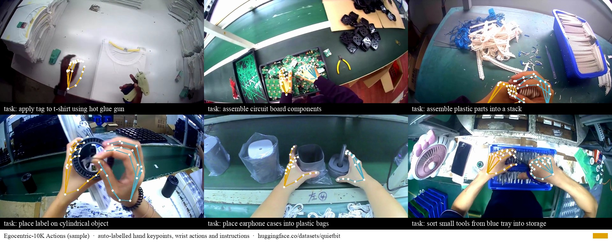

# ego2lerobot

**Turn first-person video into robot training data.** Point it at head-mounted or chest-mounted video of people working. It finds the hands in every frame, lifts them to 3D, derives wrist and grip actions, cuts the video into sub-steps at action boundaries and writes a checked instruction for each one. The output is a [LeRobot v3](https://huggingface.co/docs/lerobot/en/lerobot-dataset-v3) dataset you can train on directly.



**Sample output:** [arete-robotics/egocentric-10k-actions-sample](https://huggingface.co/datasets/arete-robotics/egocentric-10k-actions-sample) has 211 episodes from 28 factories in [Egocentric-10K](https://huggingface.co/datasets/builddotai/Egocentric-10K), labelled with this tool on one Mac mini in about two hours.

## Install
```bash
pip install git+https://github.com/arete-robotics/ego2lerobot
# instructions from a vision-language model (Apple silicon):
pip install "ego2lerobot[caption] @ git+https://github.com/arete-robotics/ego2lerobot"
# ... or on Linux with an NVIDIA GPU (see docs/linux_gpu.md):
pip install "ego2lerobot[caption-cuda] @ git+https://github.com/arete-robotics/ego2lerobot"
```

## Use
```bash
# Calibrated camera (OpenCV pinhole or fisheye intrinsics as JSON, e.g. Egocentric-10K's intrinsics.json)
ego2lerobot run videos/*.mp4 --out my_dataset --intrinsics intrinsics.json --caption --preview previews/

# Uncalibrated video: give the horizontal field of view instead
ego2lerobot run clip.mp4 --out my_dataset --hfov 90 --default-task "fold the towel"

# Ultra-wide action camera at 4K/60 fps: make 1080p/30 fps proxies first, then use the nominal fisheye preset
ego2lerobot prepare raw/*.MP4 --out proxy/
ego2lerobot run proxy/*.mp4 --out my_dataset --camera action-ultrawide --preview previews/
```
`--camera action-ultrawide` is a nominal lens (equidistant fisheye, 124° horizontal, from a 155° spec-sheet FOV), not a
calibration; a checkerboard calibration passed as `--intrinsics` is always better. `--rectify` runs hand detection on a
rectilinear view of a fisheye frame and maps the keypoints back; it is off by default because on calibrated
Egocentric-10K fisheye clips it found fewer hands than the raw frame. How to film: [docs/capture_advice.md](docs/capture_advice.md).

Every run also writes **`qc_report.md`** (plus `.json` and `.html`) into the dataset: detection rate per hand, hands
cut by the image border, wrist jitter and implausible distances, step lengths, dropped segments with reasons,
caption coverage, the share of captions that passed verification, and unusable time ranges. These are automatic
checks without ground truth.

`--segment fixed` reproduces datasets made before sub-steps (version 0.1): stretches with hands in view split into
equal parts of at most `--max-seconds`, 3 s minimum, and the earlier one-question captions.
`ego2lerobot qc my_dataset` rebuilds it.
Then load the result:
```python
from lerobot.datasets.lerobot_dataset import LeRobotDataset
ds = LeRobotDataset("local/ego2lerobot", root="my_dataset")
```

## What you get per frame
| Key | Shape | Content |
|---|---|---|
| `observation.images.ego` | H×W×3 video | The original view, 640 wide by default |
| `observation.intrinsics` | 8 | fx, fy, cx, cy, k1–k4 for that image |
| `observation.hands.kp2d` | 126 | [left, right] × 21 joints × (u, v, score) |
| `observation.hands.kp3d` | 126 | [left, right] × 21 joints × (x, y, z), metres, camera frame (x right, y down, z forward) |
| `observation.hands.valid` | 2 | Hand found (1) or not (0) |
| `observation.hands.ee` | 20 | Per hand: wrist xyz, palm rotation (6D), thumb–index pinch distance |
| `action` | 20 | `observation.hands.ee` of the next kept frame |
| `task` | text | Per episode (one sub-step): from `--caption`, or `--default-task` |

`meta/episodes_info.json` holds, per episode: source video and frames, how its start and end were chosen (`cuts`), the
object, touched objects, `verified` and `confidence` of the instruction with the second caption (`check`), grasp and
release events (seconds from the episode start) and hand coverage. `meta/grasp_events.json` has the grasp/release
timeline of each hand over the whole video; `meta/run.json` the settings, every candidate boundary with the model's
decision, and every step found, kept or not.

## How it works
1. **Hands**: [MediaPipe Hand Landmarker](https://ai.google.dev/edge/mediapipe/solutions/vision/hand_landmarker) in video mode, two hands, on every frame.
2. **3D**: MediaPipe's metric hand shape is placed in the camera frame. A least-squares fit finds the translation that projects it onto the detected keypoints, after removing lens distortion (pinhole or OpenCV fisheye).
3. **Actions**: a palm frame from the wrist and the index and little-finger knuckles, plus the thumb–index distance as grip. Each frame's action is the next frame's wrist pose and grip.
4. **Grasp events**: per hand, the grip aperture (thumb–index tip distance over palm length) with hysteresis and a 0.3 s minimum gives a timeline of grasps (closing) and releases (opening).
5. **Sub-steps**: inside each stretch with hands in view (gaps under 1 s bridged), candidate boundaries come from the hand signals: grasp and release, a hand entering or leaving the view, wrist pauses, the hands meeting or parting. With `--caption` the model looks at frames just before and just after each candidate and says whether a new step starts there; confirmed cuts are kept strongest first, at least `--min-seconds` (2 s) apart, and steps longer than `--max-seconds` (15 s) are split at their strongest remaining candidate. Without `--caption`, a cut needs two signals agreeing.
6. **Language** (optional): [Qwen3-VL](https://huggingface.co/Qwen/Qwen3-VL-8B-Instruct) sees three full frames of the step and three close-ups cropped around the hands (so that what is in the hands counts, not finished items in the background) and writes an imperative instruction naming the object. Touching steps whose captions agree (the same kind of action on the same object) are merged and captioned again. Each final step is then captioned a second time from other moments of the step, without the first answer; if the two disagree on the action or the object, or the instruction is not an imperative naming the object, the step is kept but marked `verified: false` (`--drop-unverified` leaves it out). It runs locally through [MLX](https://github.com/Blaizzy/mlx-vlm) on Apple silicon, through Hugging Face transformers on an NVIDIA GPU (`--caption-backend transformers`), or on any OpenAI-compatible server such as vLLM (`--caption-url http://host:8000/v1`). Same prompts and output for all three; see [docs/linux_gpu.md](docs/linux_gpu.md). Steps it calls idle are dropped.

Everything runs locally; no video leaves your machine.

## Stereo
With a calibrated head-mounted stereo pair, `ego2lerobot stereo` measures hand depth by triangulation instead of estimating it from hand size.
```bash
ego2lerobot stereo left.mp4 right.mp4 --calib stereo.json --out my_dataset --imu imu.csv --preview previews/
# one side-by-side file per clip, left camera in the left half
ego2lerobot stereo --sbs pair1.mp4 pair2.mp4 --calib stereo.json --out my_dataset --caption
```
The calibration uses OpenCV conventions (pixels, metres; x right, y down, z forward):
```json
{"image_width": 1920, "image_height": 1080, "model": "pinhole",
 "left":  {"fx": 1050, "fy": 1050, "cx": 960, "cy": 540, "distortion": [-0.28, 0.09, 0.001, -0.0005, -0.01]},
 "right": {"fx": 1046, "fy": 1046, "cx": 955, "cy": 538, "distortion": [-0.27, 0.08, -0.0008, 0.0004, -0.012]},
 "R": [[1, 0, 0], [0, 1, 0], [0, 0, 1]], "T": [-0.063, 0, 0]}
```
`R` and `T` map a point from the left camera frame to the right one, as returned by OpenCV's `stereoCalibrate`. For fisheye lenses set `"model": "fisheye"` and give `[k1, k2, k3, k4]`. For a pair that is already rectified, give `fx`, `fy`, `cx`, `cy` and `baseline` (metres) instead of `left`, `right`, `R` and `T`. The IMU file is a CSV with a header row whose first column `t` is seconds since the first video frame; the other columns are passed through.

How it works: MediaPipe finds the hands in both views; the two hands are matched across views (both handedness pairings are tried); both views are rectified (Bouguet, as OpenCV's `stereoRectify`) and the 21 joints are triangulated in the left camera frame. A hand is rejected when its rows disagree after rectification (epipolar check), when it lies outside 0.1–1.5 m, or when its palm is not hand-sized; single joints with a large reprojection error are dropped (`--max-epipolar`, `--max-reprojection`, `--max-depth` set the limits). Spikes are removed, gaps up to 0.35 s are filled, joints are smoothed (Savitzky–Golay) and bone lengths are held near their median over the clip. Wrist pose, grip, captions and the LeRobot export then work as in `run`; episodes are still cut into equal parts (as `run --segment fixed`).

The dataset stores `observation.images.left` and `.right`, per-camera intrinsics (`observation.intrinsics.left` / `.right`: fx, fy, cx, cy, d0–d4 at the stored size), `observation.extrinsics` (R row by row, then T), the 2D detections in each view, the triangulated `observation.hands.kp3d` with a per-joint `kp3d_status` (0 unknown, 1 triangulated, 2 filled across a gap), `ee`, `action` and, with `--imu`, `observation.imu` (the mean of the samples around each kept frame). `meta/calibration.json` holds the calibration, `meta/imu/` the raw IMU per episode, and `meta/triangulation_stats.json` the QC numbers: valid-triangulation rate, rejections by reason, median epipolar and reprojection errors, wrist depth range, and the same per frame and hand.

`--rtmpose` adds RTMPose-m hand keypoints ([rtmlib](https://github.com/Tau-J/rtmlib), `pip install "ego2lerobot[rtmpose]"`) as a second model, fused with MediaPipe per joint. It is off by default: the code is Apache 2.0, but the published weights were trained on hand datasets that include FreiHAND and RHD, whose terms prohibit commercial use.

Stereo limits: the two videos must start on the same frame (frames are paired by index); depth error grows with the square of distance (about 4 mm per pixel of disparity error at 0.5 m with f = 1000 px and a 6 cm baseline); 3D is relative to the head, because camera pose is not estimated; the IMU is passed through, not used.

## Limitations
- **Depth comes from the average human hand size, not a depth sensor.** Expect errors of a few centimetres in distance.
- Fast, blurred or gloved hands are often missed. Left and right are sometimes swapped when only one hand is visible.
- Captions are machine-written and can be generic or wrong; check them before relying on them. The verification pass catches only some wrong captions, and `verified: true` is not proof.
- Step boundaries come from noisy hand signals and one model's judgement; expect missed and extra cuts, especially for short steps (about 2 s) and when the hands leave the view.
- The language step needs Apple silicon or a GPU. The GPU path is new and not yet verified on real hardware (checklist in [docs/linux_gpu.md](docs/linux_gpu.md)). Detection, 3D, export and the QC report run anywhere Python runs.

## Licences
- **Code:** Apache 2.0.
- **Models it downloads:** MediaPipe Hand Landmarker (Apache 2.0) and Qwen3-VL (Apache 2.0). Both allow commercial use.
- **Optional, off by default:** RTMPose-m hand weights (OpenMMLab), only with `stereo --rtmpose`. Their training data includes research-only datasets; check the terms before commercial use.
- **No MANO-based models** are used, because MANO is non-commercial.

## Labelling as a service
If you would rather not run this yourself, or you need larger volumes, measured depth (iPhone LiDAR capture), custom segmentation or QA, [Arete Robotics](https://huggingface.co/arete-robotics) will label your video. Send a few minutes of footage to **hello@arete-robotics.com** and we will label it for free so you can judge the quality.

## Cite
```bibtex
@software{liu2026ego2lerobot,
  author = {Liu, Zhao},
  title = {ego2lerobot: first-person video to LeRobot datasets},
  year = {2026},
  url = {https://github.com/arete-robotics/ego2lerobot}
}
```

*א · Arete Robotics*
