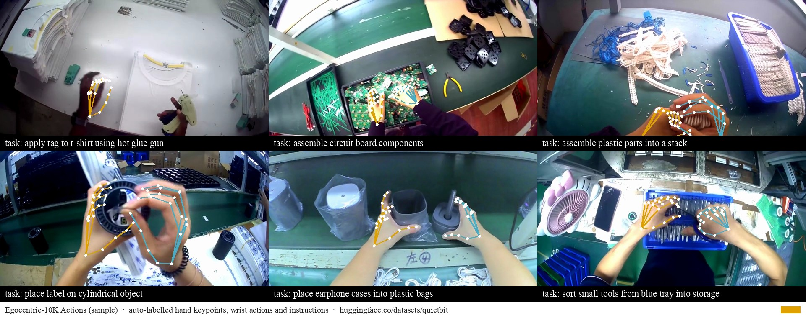

# ego2lerobot

**Turn first-person video into robot training data.** Point it at head-mounted or chest-mounted video of people working. It finds the hands in every frame, lifts them to 3D, derives wrist and grip actions, cuts the video into episodes and writes an instruction for each one. The output is a [LeRobot v3](https://huggingface.co/docs/lerobot/en/lerobot-dataset-v3) dataset you can train on directly.



**Sample output:** [arete-robotics/egocentric-10k-actions-sample](https://huggingface.co/datasets/arete-robotics/egocentric-10k-actions-sample) has 211 episodes from 28 factories in [Egocentric-10K](https://huggingface.co/datasets/builddotai/Egocentric-10K), labelled with this tool on one Mac mini in about two hours.

## Install
```bash
pip install git+https://github.com/ChizkiyahuOhayon/ego2lerobot
# instructions from a vision-language model (Apple silicon):
pip install "ego2lerobot[caption] @ git+https://github.com/ChizkiyahuOhayon/ego2lerobot"
```

## Use
```bash
# Calibrated camera (OpenCV pinhole or fisheye intrinsics as JSON, e.g. Egocentric-10K's intrinsics.json)
ego2lerobot run videos/*.mp4 --out my_dataset --intrinsics intrinsics.json --caption --preview previews/

# Uncalibrated video: give the horizontal field of view instead
ego2lerobot run clip.mp4 --out my_dataset --hfov 90 --default-task "fold the towel"
```
Then load the result:
```python
from lerobot.datasets.lerobot_dataset import LeRobotDataset
ds = LeRobotDataset("local/ego2lerobot", root="my_dataset")
```

## What you get per frame
| Key | Shape | Content |
|---|---|---|
| `observation.images.ego` | H×W×3 video | The original view, 640 wide by default |
| `observation.intrinsics` | 8 | fx, fy, cx, cy, k1–k4 for that image |
| `observation.hands.kp2d` | 126 | [left, right] × 21 joints × (u, v, score) |
| `observation.hands.kp3d` | 126 | [left, right] × 21 joints × (x, y, z), metres, camera frame (x right, y down, z forward) |
| `observation.hands.valid` | 2 | Hand found (1) or not (0) |
| `observation.hands.ee` | 20 | Per hand: wrist xyz, palm rotation (6D), thumb–index pinch distance |
| `action` | 20 | `observation.hands.ee` of the next kept frame |
| `task` | text | Per episode: from `--caption`, or `--default-task` |

`meta/episodes_info.json` holds each episode's source video and frames, sub-steps, touched objects and hand coverage.

## How it works
1. **Hands**: [MediaPipe Hand Landmarker](https://ai.google.dev/edge/mediapipe/solutions/vision/hand_landmarker) in video mode, two hands, on every frame.
2. **3D**: MediaPipe's metric hand shape is placed in the camera frame. A least-squares fit finds the translation that projects it onto the detected keypoints, after removing lens distortion (pinhole or OpenCV fisheye).
3. **Actions**: a palm frame from the wrist and the index and little-finger knuckles, plus the thumb–index distance as grip. Each frame's action is the next frame's wrist pose and grip.
4. **Episodes**: stretches where hands are in view, 3–15 s long. Gaps under 1 s are bridged.
5. **Language** (optional): [Qwen3-VL](https://huggingface.co/Qwen/Qwen3-VL-8B-Instruct) sees 4 frames per episode and writes an instruction, sub-steps and objects. It runs locally through [MLX](https://github.com/Blaizzy/mlx-vlm). Episodes it calls idle are dropped.

Everything runs locally; no video leaves your machine.

## Limitations
- **Depth comes from the average human hand size, not a depth sensor.** Expect errors of a few centimetres in distance.
- Fast, blurred or gloved hands are often missed. Left and right are sometimes swapped when only one hand is visible.
- Captions are machine-written and can be generic or wrong; check them before relying on them.
- The language step needs Apple silicon today. Detection, 3D and export run anywhere Python runs.

## Licences
- **Code:** Apache 2.0.
- **Models it downloads:** MediaPipe Hand Landmarker (Apache 2.0) and Qwen3-VL (Apache 2.0). Both allow commercial use.
- **No MANO-based models** are used, because MANO is non-commercial.

## Labelling as a service
If you would rather not run this yourself, or you need larger volumes, measured depth (iPhone LiDAR capture), custom segmentation or QA, [Arete Robotics](https://huggingface.co/arete-robotics) will label your video. Send a few minutes of footage to **hello@arete-robotics.com** and we will label it for free so you can judge the quality.

## Cite
```bibtex
@software{liu2026ego2lerobot,
  author = {Liu, Zhao},
  title = {ego2lerobot: first-person video to LeRobot datasets},
  year = {2026},
  url = {https://github.com/ChizkiyahuOhayon/ego2lerobot}
}
```

*א · Arete Robotics*
